# apotech_flutter_uts

A new Flutter project.

## Getting Started

This project is a starting point for a Flutter application.

A few resources to get you started if this is your first Flutter project:

- [Learn Flutter](https://docs.flutter.dev/get-started/learn-flutter)
- [Write your first Flutter app](https://docs.flutter.dev/get-started/codelab)
- [Flutter learning resources](https://docs.flutter.dev/reference/learning-resources)

For help getting started with Flutter development, view the
[online documentation](https://docs.flutter.dev/), which offers tutorials,
samples, guidance on mobile development, and a full API reference.
# ApoTech – Sistem Informasi Apotek

## 1. Deskripsi Proyek

**ApoTech** merupakan aplikasi berbasis mobile yang dikembangkan menggunakan Flutter sebagai sistem informasi apotek. Aplikasi ini bertujuan membantu masyarakat memperoleh informasi mengenai obat dan apotek, khususnya informasi ketersediaan obat, harga obat, serta layanan pemesanan obat tanpa harus terlebih dahulu datang langsung ke lokasi apotek.

Melalui aplikasi ini, pengguna diharapkan dapat mengetahui ketersediaan obat di apotek tertentu, membandingkan informasi obat dan harga, serta melakukan pemesanan untuk mempermudah proses pengambilan obat. Dengan demikian, ApoTech diharapkan dapat meningkatkan efisiensi masyarakat dalam mencari dan memperoleh obat sesuai kebutuhan.

**Catatan pengembangan:** Pada tahap proyek UTS ini, ApoTech dikembangkan dengan berfokus pada perspektif pelanggan atau pengguna aplikasi. Pengembangan berikutnya pada tahap UAS direncanakan mencakup sisi admin atau pemilik apotek. Oleh karena itu, beberapa pengelolaan data dan proses CRUD masih memiliki keterbatasan dan akan disempurnakan pada tahap pengembangan selanjutnya.

### Latar Belakang

Pengembangan ApoTech berawal dari pengamatan terhadap aplikasi kesehatan yang telah tersedia. Meskipun aplikasi kesehatan dapat memberikan berbagai informasi, masih terdapat kebutuhan untuk memperoleh informasi apotek secara lebih lengkap, terutama mengenai lokasi apotek, jam operasional, ketersediaan obat, dan harga obat.

Kebutuhan tersebut juga berangkat dari pengalaman pribadi pengembang sebagai seseorang yang merantau dari luar kota. Ketika berada di lingkungan yang belum terlalu dikenal, mencari apotek terdekat bukanlah satu-satunya kendala. Informasi mengenai apakah apotek sedang buka, apakah obat yang dibutuhkan tersedia, dan berapa harga obat tersebut juga menjadi hal penting.

Informasi lokasi melalui peta digital memang dapat membantu menemukan apotek, tetapi belum tentu memberikan informasi ketersediaan obat dan harga secara terperinci. Selain itu, masyarakat juga membutuhkan informasi tersebut agar dapat mempertimbangkan pilihan apotek sesuai kebutuhan dan kemampuan biaya.

Berdasarkan permasalahan tersebut, ApoTech dikembangkan sebagai upaya untuk menyederhanakan pencarian informasi apotek dan proses pemesanan obat melalui satu aplikasi mobile.

## 2. Identitas Pengembang

| Keterangan | Informasi |
|---|---|
| Nama | Kadek Ayu Aulia |
| NIM | 2415051041 |
| Kelas | PTI 5D |
| Nama Proyek | ApoTech |
| Tema | Sistem Informasi Apotek |
| Platform | Android |

## 3. Fitur Aplikasi

Berikut merupakan fitur-fitur yang tersedia dalam pengembangan ApoTech pada tahap UTS.

### 3.1 Katalog Obat
Menampilkan informasi obat yang diperoleh melalui REST API OpenFDA. Pengguna dapat melihat daftar obat beserta informasi yang tersedia pada data API. Data OpenFDA digunakan sebagai sumber informasi katalog obat dan tidak digunakan secara langsung untuk mengubah atau mengelola data obat.

### 3.2 Informasi Apotek Terdekat
Menyediakan informasi beberapa apotek yang dapat dipilih oleh pengguna. Pengguna dapat memilih apotek tertentu untuk melihat informasi dan ketersediaan obat berdasarkan data apotek tersebut.

### 3.3 Informasi Ketersediaan Obat
Menampilkan informasi ketersediaan obat pada apotek yang dipilih. Fitur ini membantu pengguna mengetahui apakah obat yang dicari tersedia sebelum melakukan pemesanan.

### 3.4 Keranjang Pemesanan
Memungkinkan pengguna memasukkan obat ke dalam keranjang pemesanan. Pengguna juga dapat mengatur kuantitas obat sebelum melanjutkan proses pemesanan.

### 3.5 Pengelolaan dan Pengecekan Pesanan
Pengguna dapat melihat pesanan yang telah dibuat beserta status pesanan. Fitur ini menyediakan beberapa pengelolaan pesanan, antara lain:

- Melihat informasi pesanan.
- Mengubah kuantitas obat.
- Membatalkan pesanan.
- Mengatur tanggal pengambilan obat.
- Mengatur jam pengambilan obat.
- Mengubah jadwal pengambilan sesuai ketentuan aplikasi.

Perubahan jadwal pengambilan dibatasi berdasarkan aturan yang diterapkan dalam aplikasi, termasuk batas maksimal perubahan tanggal pengambilan hingga dua hari setelah jadwal awal.

### 3.6 Struk Pemesanan
Menampilkan ringkasan pemesanan setelah pengguna menyelesaikan proses pemesanan. Informasi yang ditampilkan meliputi rincian obat dan total pembayaran.

### 3.7 Produk Tersimpan
Menyediakan fitur untuk menyimpan daftar produk yang ingin dilihat atau dipesan kembali. Pengguna dapat menghapus produk dari daftar tersimpan maupun mengarahkannya ke keranjang pemesanan.

Fitur ini terinspirasi dari konsep daftar tersimpan dan keranjang pada aplikasi perdagangan elektronik.

### 3.8 Profil Pengguna
Menampilkan informasi profil pengguna atau pelanggan yang menggunakan aplikasi.

### 3.9 Feedback
Menyediakan fitur bagi pengguna untuk memberikan masukan atau tanggapan terhadap aplikasi.

### 3.10 Informasi Kesehatan
Menyediakan halaman informasi kesehatan. Konten pada halaman ini masih memerlukan pengembangan lebih lanjut.

### 3.11 SOS Darurat
Menyediakan akses untuk membantu pengguna menghubungi layanan atau fasilitas kesehatan dalam kondisi darurat. Fitur ini diarahkan untuk kebutuhan bantuan kesehatan, bukan untuk menghubungi apotek sebagai layanan darurat.

## 4. Fitur yang Direncanakan untuk Pengembangan Selanjutnya

Beberapa fitur masih memerlukan pengembangan lebih lanjut, antara lain:

- **Informasi lokasi:** pengembangan informasi lokasi apotek yang lebih lengkap.
- **Informasi kesehatan:** pengisian dan pengembangan konten informasi kesehatan.
- **Sistem admin apotek:** pengelolaan data apotek, obat, harga, dan ketersediaan obat dari sisi admin atau pemilik apotek.
- **Penyempurnaan CRUD:** penyempurnaan pengelolaan data agar lebih lengkap dan terintegrasi antara pelanggan dan admin.

Pengembangan fitur-fitur tersebut direncanakan sebagai bagian dari pengembangan aplikasi pada tahap UAS.

## 5. Teknologi yang Digunakan

| Teknologi | Kegunaan |
|---|---|
| Flutter | Framework untuk membangun aplikasi mobile. |
| Dart | Bahasa pemrograman yang digunakan dalam pengembangan aplikasi. |
| Provider | Pengelolaan state aplikasi menggunakan Provider dan ChangeNotifier. |
| Supabase | Backend dan database untuk penyimpanan serta pengelolaan data aplikasi. |
| OpenFDA API | REST API untuk memperoleh data informasi obat. |

## 6. REST API

ApoTech menggunakan **OpenFDA API**, khususnya Drug NDC API, sebagai sumber data katalog obat.

Endpoint yang digunakan:

`https://api.fda.gov/drug/ndc.json`

API tersebut digunakan untuk mengambil data obat yang kemudian diproses dan ditampilkan pada halaman katalog aplikasi.

Data API diolah melalui proses parsing JSON ke dalam model Dart agar dapat digunakan oleh aplikasi Flutter.

## 7. Backend dan Database

ApoTech menggunakan **Supabase** sebagai layanan backend berbasis PostgreSQL.

Supabase digunakan untuk menyimpan dan mengelola data yang diperlukan dalam aplikasi, termasuk data obat, apotek, ketersediaan obat, pesanan, profil pengguna, serta produk tersimpan.

Pengelolaan data dilakukan melalui proses CRUD (Create, Read, Update, Delete) pada bagian aplikasi yang telah diimplementasikan, terutama pengelolaan pesanan, profil, dan produk tersimpan.

## 8. Arsitektur Proyek

Pengembangan ApoTech menerapkan pemisahan tanggung jawab kode agar struktur proyek lebih terorganisasi, mudah dipahami, dan dapat dikembangkan kembali.

Bagian utama arsitektur proyek meliputi:

- **Models:** mendefinisikan struktur data dan model objek yang digunakan aplikasi.
- **Services:** menangani komunikasi dengan layanan eksternal, seperti REST API OpenFDA dan Supabase, serta proses pengelolaan data.
- **Repositories:** menjadi penghubung antara provider dengan sumber data.
- **Providers:** mengelola state aplikasi menggunakan Provider dan ChangeNotifier.
- **Screens:** berisi halaman atau tampilan antarmuka aplikasi.
- **Widgets:** berisi komponen antarmuka yang dapat digunakan kembali.
- **Constants:** menyimpan konstanta dan konfigurasi tampilan aplikasi.

### 8.1 Struktur Folder Proyek

Berikut merupakan struktur folder utama proyek ApoTech berdasarkan hasil pemeriksaan direktori `lib` melalui terminal:

```text
lib/
│   app.dart
│   main.dart
│
├── constants/
│   ├── app_constants.dart
│   └── app_theme.dart
│
├── models/
│   ├── medicine.dart
│   ├── openfda_product.dart
│   ├── order.dart
│   └── profile.dart
│
├── providers/
│   ├── cart_provider.dart
│   ├── favorite_provider.dart
│   ├── medicine_provider.dart
│   ├── openfda_provider.dart
│   ├── order_provider.dart
│   └── profile_provider.dart
│
├── repositories/
│   ├── medicine_repository.dart
│   ├── openfda_repository.dart
│   ├── profile_repository.dart
│   └── saved_product_repository.dart
│
├── screens/
│   ├── main_navigation_screen.dart
│   ├── openfda_test_screen.dart
│   ├── cart/
│   │   ├── cart_screen.dart
│   │   └── checkout_screen.dart
│   ├── favorites/
│   ├── feedback/
│   │   └── feedback_screen.dart
│   ├── health/
│   │   └── health_information_screen.dart
│   ├── home/
│   │   └── home_screen.dart
│   ├── medicines/
│   │   ├── favorite_screen.dart
│   │   ├── medicine_detail_screen.dart
│   │   ├── medicine_list_screen.dart
│   │   └── openfda_product_detail_screen.dart
│   ├── orders/
│   │   └── order_history_screen.dart
│   ├── pharmacies/
│   │   ├── pharmacy_detail_screen.dart
│   │   └── pharmacy_list_screen.dart
│   ├── profile/
│   │   ├── edit_profile_screen.dart
│   │   └── profile_screen.dart
│   └── settings/
│
├── services/
│   ├── feedback_service.dart
│   ├── local_medicine_service.dart
│   ├── openfda_inventory_service.dart
│   ├── openfda_service.dart
│   ├── order_service.dart
│   ├── profile_service.dart
│   └── saved_product_service.dart
│
└── widgets/
    ├── empty_state_widget.dart
    ├── error_state_widget.dart
    ├── loading_widget.dart
    └── responsive_content.dart
```

### 8.2 Penjelasan Pembagian Arsitektur

1. **Models:** Berisi model data seperti `medicine.dart`, `openfda_product.dart`, `order.dart`, dan `profile.dart`.
2. **Services:** Menangani komunikasi dan proses pengelolaan data, termasuk layanan OpenFDA, pesanan, profil, dan produk tersimpan.
3. **Repositories:** Menghubungkan provider dengan sumber data melalui repository obat, OpenFDA, profil, dan produk tersimpan.
4. **Providers:** Mengelola state aplikasi, seperti keranjang, favorit, obat, data OpenFDA, pesanan, dan profil.
5. **Screens:** Berisi halaman aplikasi yang dikelompokkan berdasarkan fungsi, seperti Home, katalog obat, apotek, keranjang, pesanan, profil, feedback, dan informasi kesehatan.
6. **Widgets:** Berisi komponen antarmuka yang digunakan kembali, seperti loading, error, empty state, dan konten responsif.
7. **Constants:** Menyimpan nilai konstanta dan tema aplikasi.

## 9. Alur Penggunaan Aplikasi

Secara umum, alur penggunaan ApoTech dari perspektif pelanggan adalah sebagai berikut:

1. Pengguna membuka aplikasi dan melihat halaman utama.
2. Pengguna dapat memilih untuk melihat katalog obat melalui menu katalog.
3. Jika ingin mencari obat berdasarkan apotek, pengguna membuka informasi apotek terdekat.
4. Pengguna memilih salah satu apotek untuk melihat informasi ketersediaan obat.
5. Pengguna dapat memasukkan obat yang tersedia ke dalam keranjang.
6. Pengguna kembali ke halaman navigasi aplikasi, kemudian membuka halaman keranjang.
7. Pengguna mengatur jumlah obat serta menentukan tanggal dan jam pengambilan.
8. Aplikasi menampilkan ringkasan pesanan dan total pembayaran.
9. Setelah pesanan dibuat, pengguna dapat membuka menu pengecekan pesanan untuk melihat status dan mengelola pesanan sesuai ketentuan aplikasi.
10. Pengguna juga dapat mengakses profil, memberikan feedback, dan menggunakan fitur lain yang tersedia.

## 10. Cara Menjalankan Aplikasi

Untuk menjalankan proyek ApoTech secara lokal, ikuti langkah berikut:

1. Pastikan Flutter SDK dan Android SDK telah terpasang.
2. Clone repository proyek:

   ```bash
   git clone https://github.com/USERNAME/REPOSITORY.git
   ```

3. Masuk ke direktori proyek:

   ```bash
   cd NAMA_FOLDER_PROYEK
   ```

4. Ambil seluruh dependensi:

   ```bash
   flutter pub get
   ```

5. Pastikan konfigurasi koneksi Supabase telah disesuaikan dengan proyek.
6. Hubungkan perangkat Android atau jalankan emulator.
7. Jalankan aplikasi:

   ```bash
   flutter run
   ```

## 11. Dokumentasi Tampilan Aplikasi

Bagian ini akan dilengkapi dengan tangkapan layar aplikasi, meliputi:

- Halaman Home.
- Halaman katalog obat.
- Halaman detail obat.
- Halaman informasi apotek.
- Halaman keranjang pemesanan.
- Halaman pengecekan pesanan.
- Halaman profil.
- Tampilan aplikasi pada ukuran layar yang berbeda.
- Tampilan data dari REST API.
- Tampilan data pada Supabase.

## 12. Penutup

ApoTech merupakan tahap awal pengembangan sistem informasi apotek berbasis mobile yang berfokus pada kebutuhan pelanggan dalam memperoleh informasi obat dan apotek.

Pengembangan aplikasi ini masih memiliki keterbatasan, baik dari segi fitur maupun pengelolaan data. Namun, melalui implementasi Flutter, Provider, REST API OpenFDA, dan Supabase, proyek ini menjadi dasar untuk pengembangan sistem informasi apotek yang lebih lengkap pada tahap berikutnya.

Pengembang berharap ApoTech dapat terus dikembangkan sehingga mampu membantu masyarakat memperoleh informasi obat, mengetahui ketersediaan obat di apotek, serta mempermudah proses pemesanan dan pengambilan obat.
## 11. Dokumentasi Tampilan Aplikasi

Bagian ini menampilkan dokumentasi antarmuka aplikasi ApoTech berdasarkan halaman dan fitur yang tersedia. Setiap tangkapan layar digunakan untuk memperlihatkan tampilan serta alur penggunaan aplikasi dari perspektif pelanggan.

### 11.1 Halaman Katalog Obat

Halaman katalog obat menampilkan daftar informasi obat yang diperoleh melalui REST API OpenFDA. Pengguna dapat mencari dan melihat informasi obat yang tersedia.

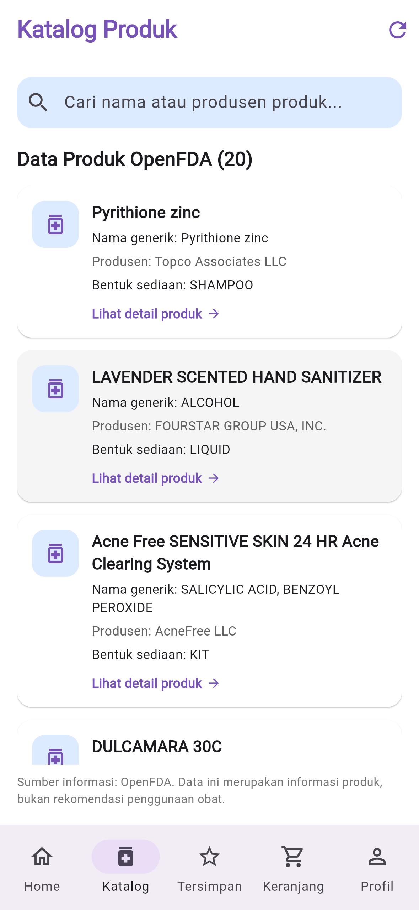

### 11.2 Halaman Produk Tersimpan

Halaman produk tersimpan menampilkan daftar obat yang telah disimpan oleh pengguna. Pengguna dapat menghapus produk dari daftar tersimpan atau memasukkannya ke keranjang pemesanan.

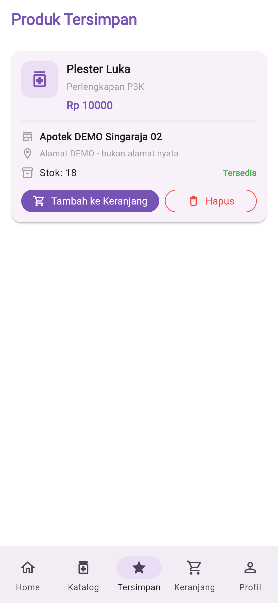

### 11.3 Halaman Keranjang

Halaman keranjang menampilkan daftar obat yang akan dipesan. Pengguna dapat melihat rincian produk, mengatur jumlah obat, dan melanjutkan proses pemesanan.

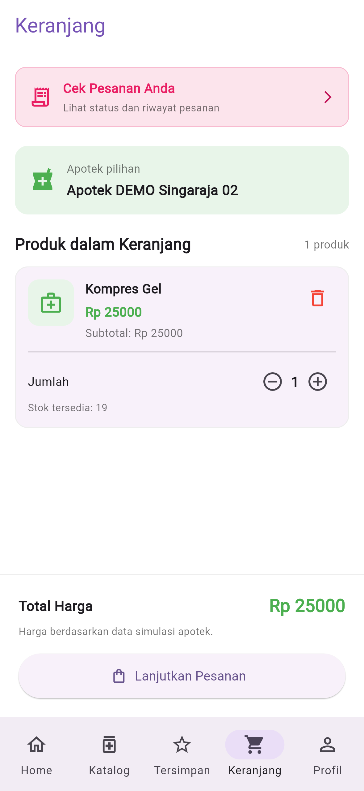

### 11.4 Halaman Profil Pengguna

Halaman profil pengguna menampilkan informasi akun pelanggan serta beberapa menu yang berkaitan dengan pengelolaan profil dan aktivitas pengguna.

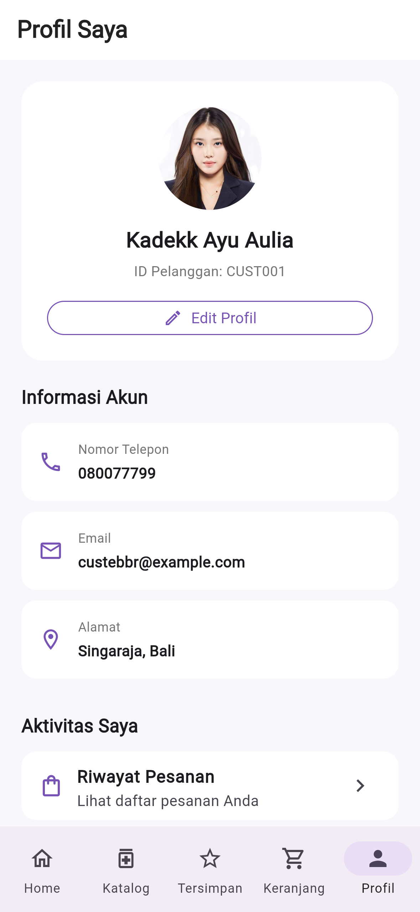

### 11.5 Halaman Apotek Terdekat

Halaman apotek terdekat menampilkan daftar apotek yang tersedia dalam aplikasi, termasuk informasi nama, alamat, dan jam operasional.

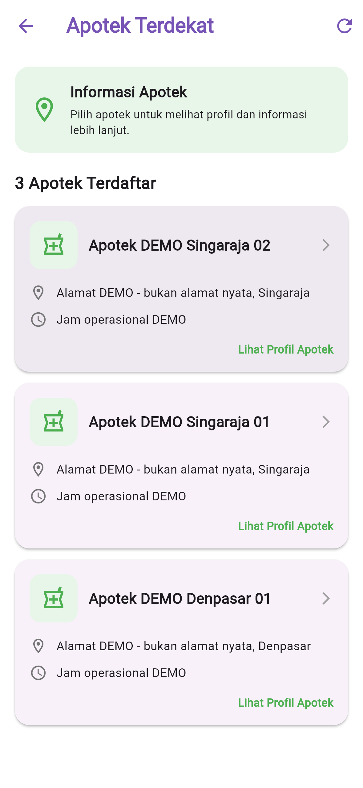

### 11.6 Halaman Profil Apotek

Halaman profil apotek menampilkan informasi lebih lanjut mengenai apotek yang dipilih, termasuk informasi apotek dan ketersediaan obat berdasarkan data yang tersimpan.

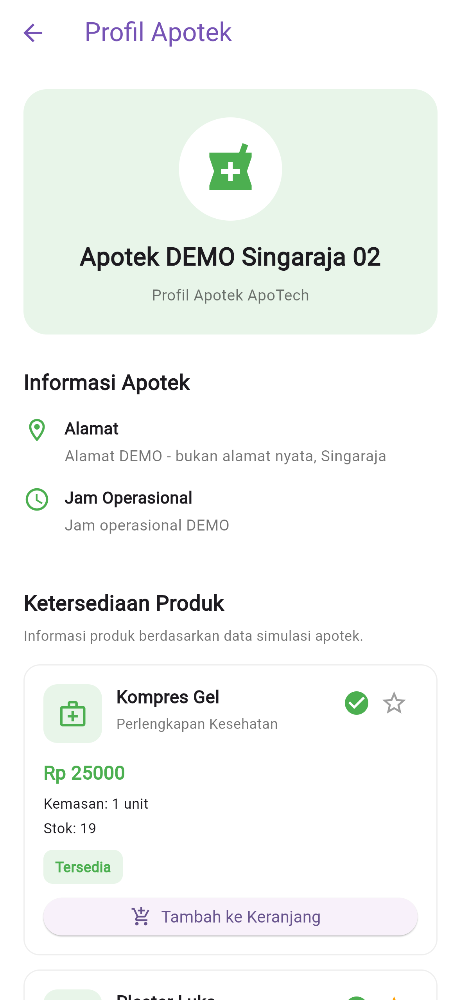

### 11.7 Halaman Pesanan Saya

Halaman pesanan saya menampilkan daftar transaksi pemesanan yang telah dibuat pengguna. Informasi yang ditampilkan meliputi rincian pesanan dan status pemesanan.

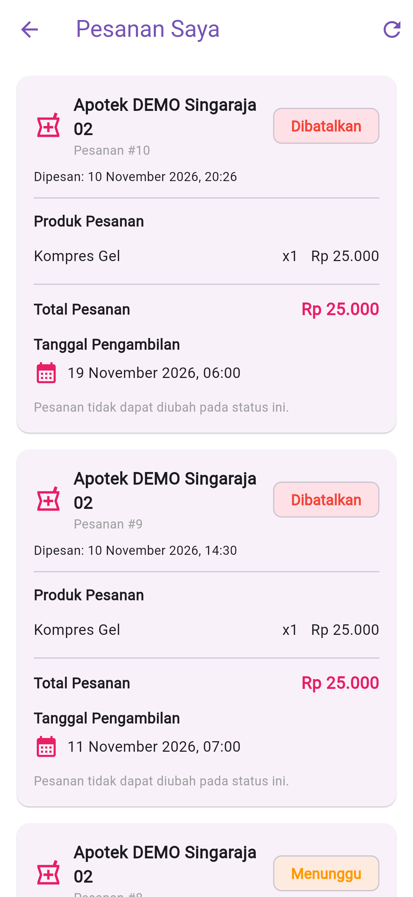

### 11.8 Halaman Konfirmasi Pesanan

Halaman konfirmasi pesanan digunakan untuk meninjau informasi pemesanan sebelum pengguna menyelesaikan proses pemesanan.

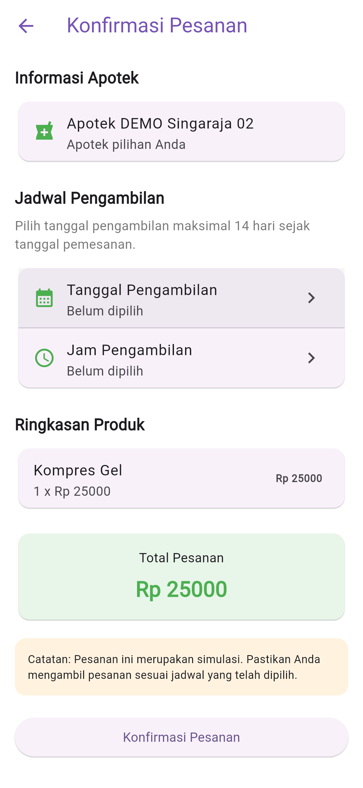

### 11.9 Pemilihan Tanggal Pengambilan

Halaman ini menyediakan fitur pemilihan tanggal pengambilan obat. Pengguna dapat menentukan tanggal pengambilan sesuai dengan ketentuan yang diterapkan aplikasi.

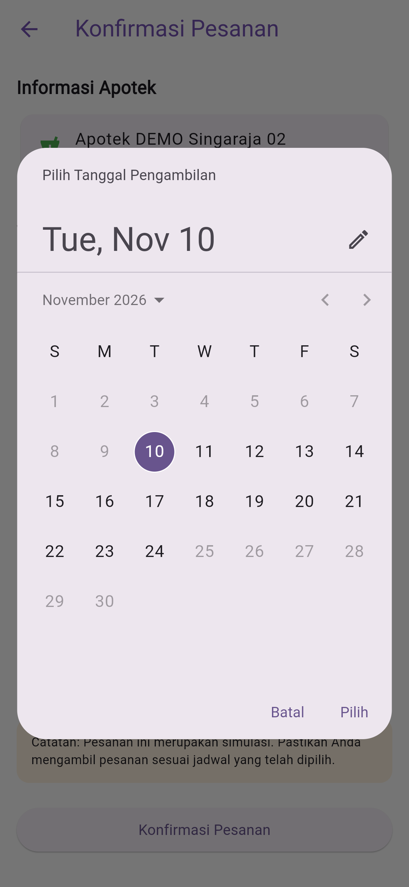

### 11.10 Pemilihan Jam Pengambilan

Pada bagian ini, pengguna dapat memilih jam pengambilan obat melalui pilihan waktu yang tersedia dalam aplikasi.

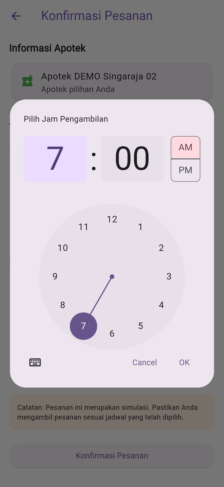

### 11.11 Ringkasan Konfirmasi Pesanan

Halaman ini menampilkan ringkasan informasi pesanan, seperti apotek yang dipilih, tanggal dan jam pengambilan, rincian obat, serta total pembayaran sebelum pesanan dikonfirmasi.

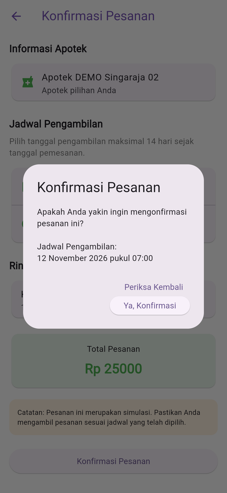

### 11.12 Halaman Pesanan Berhasil Dibuat

Halaman ini menampilkan pemberitahuan bahwa proses pemesanan berhasil dilakukan. Pengguna dapat melihat informasi bahwa pesanan telah berhasil dibuat.

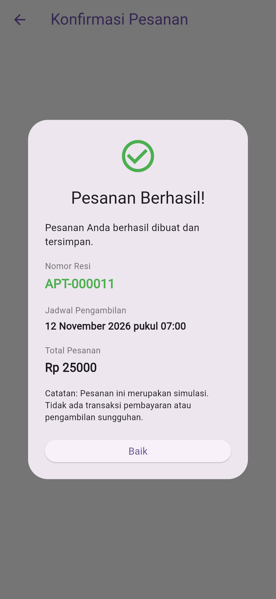

### 11.13 Halaman Feedback

Halaman feedback menyediakan formulir bagi pengguna untuk memberikan penilaian, masukan, maupun tanggapan terhadap aplikasi ApoTech.

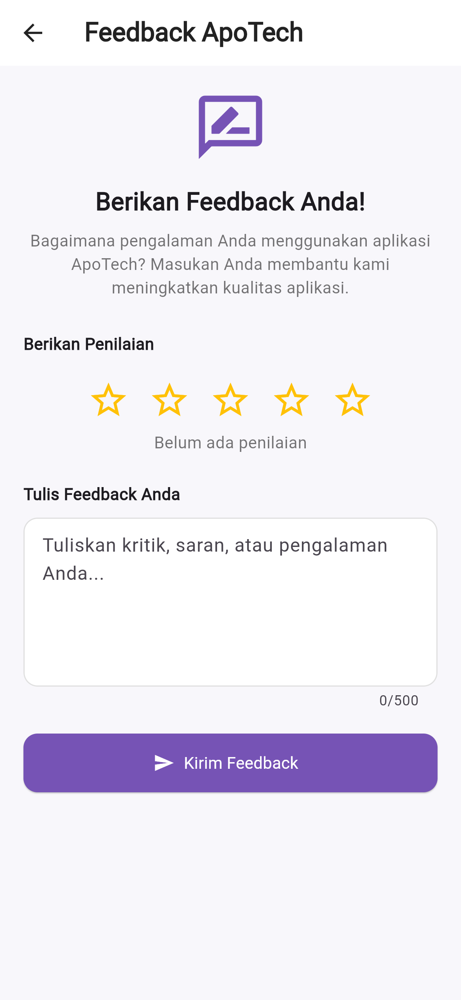

### 11.14 Halaman Homepage

Halaman homepage merupakan halaman utama aplikasi ApoTech yang menyediakan akses menuju berbagai fitur utama, seperti katalog obat, produk tersimpan, apotek terdekat, dan menu lainnya.

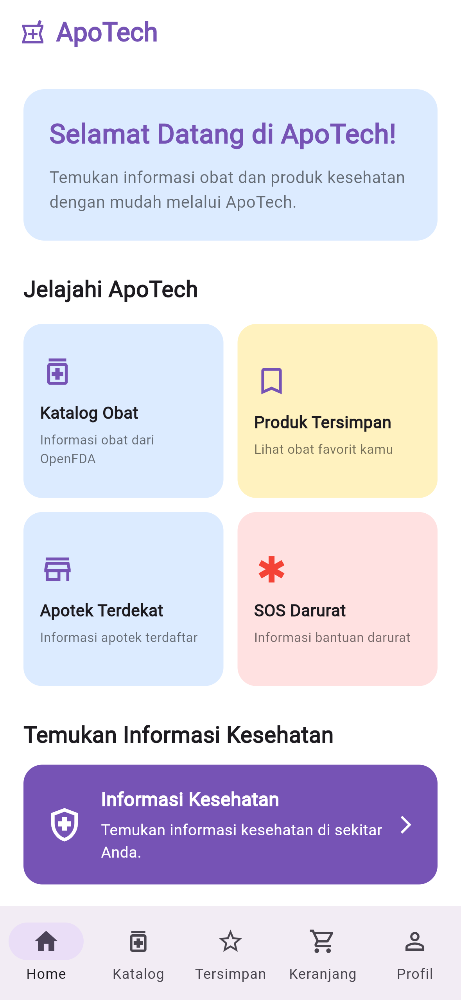